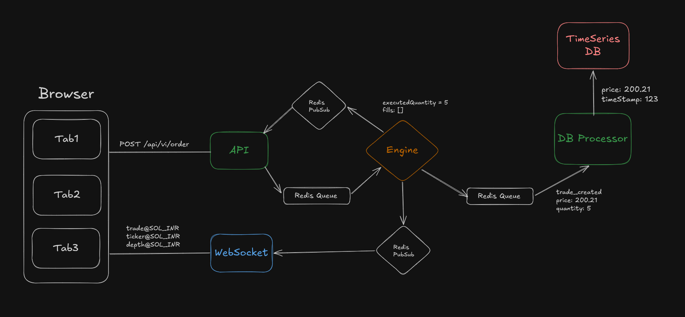
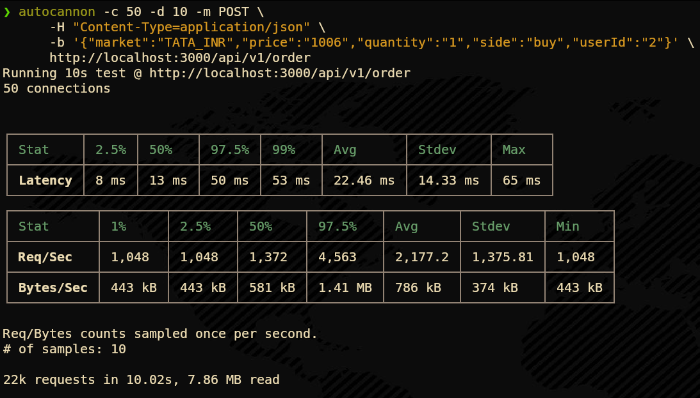
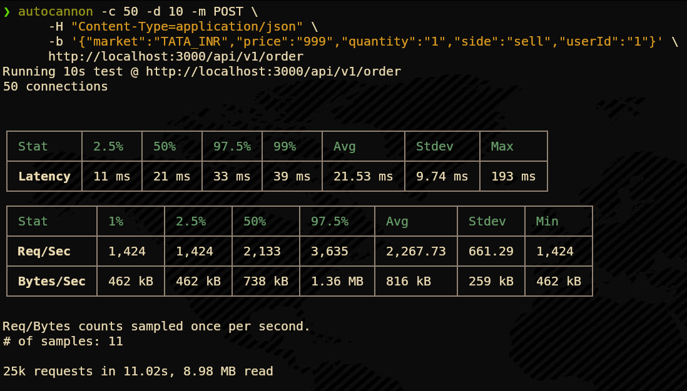
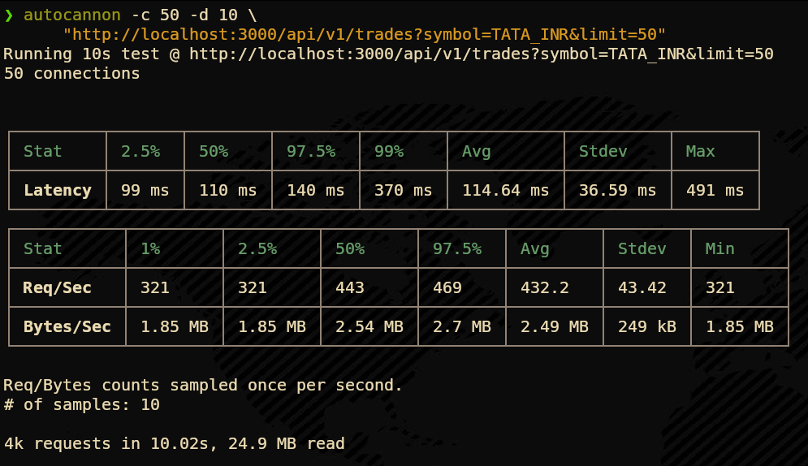
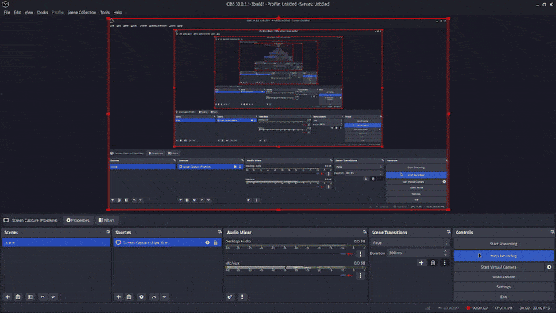
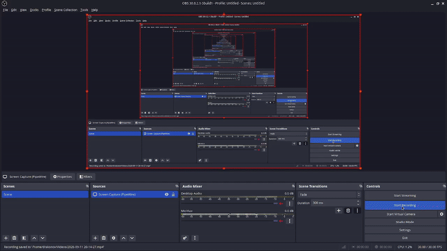

# Arcturus ⚡
> A simulated exchange with a React trading screen, exact in-memory matching, Redis messaging and live market data.

**Development status:** Milestone 2 adds the first functional trading screen, demo
sessions, account ownership and request recovery. Public deployment remains pending.
Verification commands and current limitations are described below.

Arcturus is an exchange backend inspired by how platforms like Binance work internally. It implements a **price-time priority matching engine**, **real-time WebSocket market data**, **asynchronous persistence via TimescaleDB**, and a **self-sustaining market maker bot** — all connected through a Redis message bus.

---

## 🏗️ Architecture



---

## 🧩 Services

| Service | Port | Responsibility |
|---|---|---|
| `frontend` | 5173 | React + TypeScript trading screen (Vite development server) |
| `api` | 3000 | REST gateway — accepts orders, serves depth/trades/klines |
| `engine` | — | In-memory matching engine, single-threaded, price-time priority |
| `ws` | 3001 | WebSocket server — real-time market data via Redis Pub/Sub |
| `db-processor` | — | Async DB writer — persists trades and orders to TimescaleDB |
| `market-maker` | — | Algorithmic liquidity bot — keeps the order book alive |

---

## ⚙️ Tech Stack

- **Runtime:** Node.js + TypeScript
- **Frontend:** React + TypeScript + Vite, TradingView Lightweight Charts, Lucide icons
- **API:** Express.js
- **Message Bus:** Redis (List queue + Pub/Sub)
- **Database:** TimescaleDB (PostgreSQL + time-series hypertables)
- **WebSockets:** `ws` library
- **Containerization:** Docker + Docker Compose
- **Load Testing:** Autocannon


---

## 📊 Performance Benchmarks

**Historical, unverified results:** the original screenshots and figures below are retained
for provenance. Reproducible scripts are not present, and these results have not been
validated against this revision. The trade endpoint now requires `symbol`; it reads
trade rows, not a candle aggregate.

Originally reported with **Autocannon** (`-c 50 connections, -d 10 seconds`) on localhost with the Market Maker bot simultaneously active.

---

### 1. Buy Order Placement — `POST /api/v1/order`

> Full pipeline: API → Redis Queue → In-Memory Engine → Redis Pub/Sub → API response



| Metric | Value |
|---|---|
| **Requests/sec (avg)** | **2,177 req/s** |
| **Requests/sec (peak)** | 4,563 req/s |
| **Avg Latency** | 22.46 ms |
| **P99 Latency** | 53 ms |
| **Max Latency** | 65 ms |
| **Total** | **22,000 orders in 10 seconds** |

---

### 2. Sell Order Placement — `POST /api/v1/order`



| Metric | Value |
|---|---|
| **Requests/sec (avg)** | **2,267 req/s** |
| **Requests/sec (peak)** | 3,635 req/s |
| **Avg Latency** | 21.53 ms |
| **P99 Latency** | 39 ms |
| **Max Latency** | 193 ms |
| **Total** | **25,000 orders in 11 seconds** |

---

### 3. Trade History — `GET /api/v1/trades?limit=50`

> Queries TimescaleDB hypertable with 10,000+ real trade records



| Metric | Value |
|---|---|
| **Requests/sec (avg)** | **432 req/s** |
| **Avg Latency** | 114.64 ms |
| **P99 Latency** | 370 ms |
| **Throughput** | 2.49 MB/sec |
| **Total** | **4,000 requests, 24.9 MB read in 10s** |

> These figures do not establish current throughput or correctness. New reproducible benchmarks are scheduled for Milestone 7.

---

## 🎬 Live Demos

### Market Maker Bot — Automated Liquidity

The Market Maker runs as an independent microservice, continuously placing and cancelling orders every 2 seconds to keep the book alive. No human users needed.



---

### Real-Time Order Execution

Live order matching and trade execution streamed through the full pipeline.


---

### Sell Orders Under Load

Stress test showing sell order processing with concurrent connections active.



---

## 🚀 Getting Started

### Prerequisites
- Node.js 24 recommended (`.nvmrc`); supported baseline: Node 22.12–24.
- npm and Docker with the Compose plugin.
- Local-only demo: default database credentials are for development.

### Install and build (from the repository root)
```bash
npm run bootstrap
npm run build
npm run typecheck
npm test
```
Each service retains its own lockfile. `bootstrap` runs `npm ci` in the contracts
package, every service and the frontend; `build` builds contracts before their consumers.
No global TypeScript installation is needed.

### Configure
Copy the `.env.example` in each service to `.env` if you need overrides. Service
commands read their own working directory's `.env`. The API, engine and WS server
use `REDIS_URL`; API and worker use the documented `POSTGRES_*` variables.
The engine's `WITH_SNAPSHOT` must be empty for a fresh start or `1` to restore.
Other nonempty values are rejected. Version 2 integer snapshots are required; legacy
floating-point snapshots must not be restored. Use an isolated fresh demo instead.

### Start
```bash
npm run infra:up
npm start
```
Compose starts Redis, TimescaleDB **and exactly one database processor**. The root
start command starts the engine, API and WebSocket server on the host, and stops the
other host processes if one exits. It does not start a duplicate database processor.
Database and Redis host ports bind to loopback only.

In a separate terminal, start the trading screen:
```bash
npm run dev:frontend
```
Open http://localhost:5173 for the galaxy landing page, or http://localhost:5173/trade for the dark trading terminal. Each fresh tab opened via **Open second trader** receives
an independent demo account with 100,000 INR and 100 SOL. Place a sell limit at 9 for
3 SOL in one tab, buy 1 SOL at 10 in the other, then cancel the seller's remainder.
The trade executes at 9; balances, recent trades and the book update live.
The book starts empty until real orders are submitted.

Frontend overrides are `VITE_API_URL` and `VITE_WS_URL` (see `frontend/.env.example`).
Set API `CORS_ORIGIN` to the frontend origin if changing host/port. Vite variables
are embedded at build time. `npm run build` creates the static frontend in `frontend/dist`.

To keep the order book and candles moving, start the simulator in a separate terminal:
```bash
npm run start:market-maker
```
Stop the host services with Ctrl+C; stop infrastructure with `npm run infra:down`.
The latter preserves the database volume. Do not run the simulator during smoke checks.

### Verification
```bash
curl http://localhost:3000/
```
For a **fresh, disposable engine and database only**:
```bash
SMOKE_DISPOSABLE=1 npm run smoke
```
The smoke check provisions two demo sessions, places real simulated orders and checks
HTTP responses, Redis-mediated matching, persisted trade history and WebSocket events.
That baseline check does not certify balance correctness, candle refresh, durability or cloud readiness.
It intentionally refuses to run without the disposable opt-in. Never run it against
an active/shared demo.

`npm test` builds all packages and runs the unit tests, including exact settlement,
price-time priority, refunds, cancellation, validation, snapshots and a seeded
500-command conservation check. API controller tests substitute the Redis transport.

For a real service integration check, start the disposable infrastructure (Compose
2.24.4 or newer), then run:

```bash
docker compose -p arcturus-m0 \
  -f docker/docker-compose.yml \
  -f docker/docker-compose.smoke.yml \
  up -d --wait redis timescaledb
SMOKE_DISPOSABLE=1 npm run test:integration
```

The runner starts host API/engine/WS/worker processes and checks fractional settlement,
refunds, cancellation, error responses, persistence, session isolation, concurrent
request deduplication, API deadlines and private WebSocket delivery. It requires
unused Redis DB 15 on localhost:16379 and PostgreSQL on localhost:15432 with the local
development credentials. It creates and removes its own database, session and queue keys, stops
its host processes and leaves logs/snapshots in a temporary directory. Run it exclusively:
Redis Pub/Sub channels are shared across logical databases. No Docker commands are run
by the test script. Port overrides: `TEST_POSTGRES_PORT`, `TEST_REDIS_PORT`,
`TEST_API_PORT`, `TEST_WS_PORT`.

To also test two real browser traders, reconnect/resync and loss of an order response:
```bash
npm --prefix frontend exec -- playwright install chromium
SMOKE_DISPOSABLE=1 npm run test:browser
```
This uses the same isolated stack plus a frontend on port 15173. Chromium tests perform
actual trades and retain desktop/mobile screenshots in the printed temporary directory.
No executions or market data are mocked; one response is deliberately dropped after
execution to verify that retrying the same request does not duplicate the order.

Stop the disposable containers afterward:

```bash
docker compose -p arcturus-m0 \
  -f docker/docker-compose.yml \
  -f docker/docker-compose.smoke.yml stop
```

The disposable PostgreSQL data uses temporary memory storage and is discarded on stop.

---

## 📡 API Endpoints

| Method | Endpoint | Description |
|---|---|---|
| `GET` | `/` | Health check |
| `POST` | `/api/v1/session` | Create or resume an eight-hour demo session |
| `GET` | `/api/v1/account` | Authoritative own balances and open orders (session required) |
| `GET` | `/api/v1/market` | Current depth and latest 50 engine executions |
| `POST` | `/api/v1/order` | Place an order for the authenticated account |
| `DELETE` | `/api/v1/order` | Cancel an order |
| `GET` | `/api/v1/order/open` | Get own open orders (session required) |
| `GET` | `/api/v1/order/history` | Own saved order lifecycle, including cancellations |
| `GET` | `/api/v1/account/trades` | Own saved executions |
| `GET` | `/api/v1/depth` | Get order book depth |
| `GET` | `/api/v1/trades` | Recent trade history |
| `GET` | `/api/v1/klines` | Stored OHLCV candles (5s / 1m) |
| `GET` | `/api/v1/tickers` | 24h ticker statistics |
| `POST` | `/api/v1/markets` | Disabled publicly; market provisioning is internal |

Market-data reads require `?symbol=SOL_INR`; open orders require
`?market=SOL_INR`. History routes also require `market`, accept `limit=1..100`
and an opaque `cursor`, and return `{ rows, nextCursor }`. Klines require the current
market snapshot's `historyId`, support `interval=5s` or `1m`, and return the latest
up to 500 bars in chronological order. Optional `startTime`/`endTime` are Unix
milliseconds; each query spans at most one day (5s) or seven days (1m).
There is no market-order type.
Private routes require `Authorization: Bearer <session-token>`; user IDs in request
bodies or queries cannot select another account. Foreign cancellation returns 404.
Create/cancel requests also require `Idempotency-Key` (8–64 letters, digits or hyphens).
The engine caches results per account/key for ten minutes, up to 10,000 entries,
rejecting new requests when full rather than evicting unexpired results. Reusing a key
with different fields returns 409. The UI retains uncertain requests and retries the
same key for up to nine minutes; check balances/orders before clearing an unresolved
request. API engine calls time out after five seconds; expired queued commands do not execute.

### Trading rules

- Positive decimal strings only: price tick `0.01`, quantity lot `0.0001`; each input
  is capped at `1,000,000`. Invalid precision, zero and non-finite values are rejected.
- BigInt arithmetic uses cents for prices, ten-thousandths for quantities and millionths
  for balances. Matching executes at the maker's price, best price first, then FIFO.
- Buy price improvement is refunded immediately. Cancellation releases only unfilled
  reserves in the correct asset. Draft state is checked for conservation, exact reserves
  and nonnegative balances before being committed.
- Error responses have `success: false`, `code` and `message`: invalid input is HTTP 400,
  unknown market/user/order is 404, insufficient funds is 422, capacity/duplicate funding
  is 409, and unexpected failures are 500.
- Demo limits: 32 markets, 10,000 resting orders per book, 1,000 accounts and 10,000
  funding transaction IDs. Self-matching remains permitted for the simulator.

### Example — Place a Buy Order
```bash
# Create a session; copy payload.token into DEMO_TOKEN locally.
curl -X POST http://localhost:3000/api/v1/session
curl -X POST http://localhost:3000/api/v1/order \
  -H "Content-Type: application/json" \
  -H "Authorization: Bearer $DEMO_TOKEN" \
  -H "Idempotency-Key: manual-buy-0001" \
  -d '{"market":"SOL_INR","price":"999","quantity":"1","side":"buy"}'
```

### Example — Subscribe to Live Feed (WebSocket)
```bash
# Connect
wscat -c ws://localhost:3001

# Authenticate for your own account notifications; wait for READY.
{"method":"AUTH","token":"<session-token>"}
# Subscribe; wait for SUBSCRIBED before fetching REST snapshots.
{"method":"SUBSCRIBE","params":["market@SOL_INR"]}
# Legacy public streams are also available:
{"method":"SUBSCRIBE","params":["depth@SOL_INR","trade@SOL_INR","ticker@SOL_INR"]}
```

---

## Architecture and current limits

- One engine processes queued commands serially; multiple engine consumers would split state.
- Orders and balances live in memory; snapshots are written every three seconds and on shutdown.
- Snapshot restoration is opt-in, writes are not atomic, and pending events are not replayed.
- Redis lists carry commands and persistence events; Pub/Sub carries replies and live data.
- Database writes remain asynchronous. Each committed command emits one batch; order
  lifecycle updates, fills and an event deduplication record commit in one SQL transaction.
  Absolute fill quantities and revisions prevent duplicate/out-of-order delivery from
  incrementing totals or reopening cancelled orders.
- Matching, settlement and cancellation use exact integer units and checked in-memory transactions.
- Sessions are bearer tokens in per-tab sessionStorage with an eight-hour Redis TTL.
  This is guest access for virtual trading, not a production identity system.
- Full market/account snapshots carry generation/revision; the UI resynchronizes on
  reconnect and every 15 seconds to recover missed Pub/Sub notifications.
- Recent executions are bounded to 50 per market. The engine maintains up to 180 real
  candles each at 5-second and 1-minute intervals, with exact fill volume. Candles survive
  snapshot restore; fresh engines build history from new executions, without backdating
  or inventing empty intervals. REST seeds/reconciles history; WS carries current bars.
  The chart backfills up to 500 stored bars and accumulates at most 1,000 bars per view.
  Engine bars win overlaps with delayed SQL responses. SQL candles aggregate actual raw
  fills with trade sequence as a timestamp tie-breaker; they include the current bucket
  without waiting for the legacy continuous aggregate refresh.
- Interactive candles/volume use TradingView Lightweight Charts (Apache 2.0); attribution
  and a TradingView link are displayed in the chart. Lucide supplies the interface icons.
- Deduplication survives a valid snapshot restore, but is not a crash-proof execution ledger.
  Losing engine state or restoring an older snapshot can lose recent requests/trades.
- Once an event reaches Redis, the single database worker claims it into a processing
  list and acknowledges only after commit. A PostgreSQL advisory lock prevents competing
  workers on the same database. Startup resumes unacknowledged claims; three failed
  attempts retain the event in `db_processor:failed`. At 1,000 failed events consumption
  pauses instead of deleting failures. Engine-to-Redis delivery and Redis durability are
  still not guaranteed; this is not end-to-end exactly-once execution.
- Session expiry does not cancel resting orders;
  accounts remain in memory until a deliberate demo reset (1,000-account cap).
- The market maker now uses its own demo session and serial ticks; its random walk still
  sends real resting quotes and small alternating taker orders to the engine. Demo
  self-matching is permitted and labelled here; all fills use actual matching/settlement.
  It budgets quotes against available funds, removes unfilled taker remainders and tries
  to cancel its resting orders on graceful shutdown. It has finite virtual funds and
  no automatic refill or automatic session replacement. Uncertain requests reuse their
  idempotency key; exhausted retries stop the simulator.
- `SIMULATOR_SEED` reproduces quote decisions from the same initial state; concurrent
  external activity can change executions. `SIMULATOR_TICKS` limits a run (0 means until
  stopped). The simulator is not a source of real Solana market prices.
- There is no coordinated engine/database restore: avoid mixing a fresh engine with old
  history in a shared demo. A persistent `historyId` separates fresh demo histories;
  snapshot restore keeps it. Restoring an old snapshot against newer SQL data is still
  unsupported. Legacy snapshots are incompatible with version 2.
- The default market is SOL_INR. Legacy seeded users 1, 2 and 5 are internal only;
  browser sessions always receive new server-generated account IDs.

The approved roadmap preserves this architecture and adds correctness, a trading frontend,
execution inspection, controlled scenarios and reproducible benchmarks incrementally.
Deployment targets are AWS EC2 Free Tier or Render Free Tier, subject to eligibility
and measured resource fit. Cloud provisioning, public HTTPS/WebSocket verification and
full-stack resource measurements are deferred to Milestone 6; zero-cost deployment has
not been verified. No real funds or cryptocurrency custody is involved.

The trading interface adapts [Aceternity UI Tabs](https://ui.aceternity.com/components/tabs) by Manu Arora, using Motion for the selection indicator, with keyboard navigation and reduced-motion support. Charts use TradingView Lightweight Charts; executions and candle data come from the engine.

The landing page uses GSAP for entrance and galaxy motion, with pause and reduced-motion controls. The galaxy is procedural canvas artwork, not market data. Landing and terminal code are loaded separately; static hosting must serve `index.html` for `/trade` (SPA fallback). The landing page does not provision an account until you enter the terminal.

The demo market is `SOL_INR` with 100 virtual SOL per new account. Prices are simulated, not live Solana market quotes. Legacy TATA snapshots are intentionally not converted: retain them separately and start a fresh demo with `WITH_SNAPSHOT` empty. SOL sessions should start fresh after switching from a stock demo. The official Solana logomark is from [Solana brand assets](https://solana.com/branding).

Landing-page scrolling uses [Lenis](https://github.com/darkroomengineering/lenis), driven by the GSAP ticker. Pausing motion or enabling reduced motion restores native scrolling. The terminal also uses Lenis for page scrolling; chart, trade-tape and order-table interactions retain native scrolling. Reduced motion restores native page scrolling.

The landing journey uses a lazy-loaded Three.js particle galaxy and GSAP ScrollTrigger to move the camera through three chapters. Desktop cursor movement adds subtle parallax. Rendering is capped at 30 FPS with a 1.5 pixel-ratio limit and fewer galaxy particles on mobile; drawing stops offscreen or in hidden tabs. Pause/reduced motion uses a static, readable layout; unavailable WebGL retains canvas artwork. The optional Three.js chunk is about 192 KB gzipped and is never loaded by the trading terminal.

### Saved history and worker recovery

The terminal's **History** tab shows only the authenticated account's orders and trades.
It polls saved records and labels their asynchronous nature; balances and open orders
continue to come directly from the engine. Failed history reads can be retried without
blocking trading. History pagination is a live view, not a frozen export.

The worker runs additive, repeatable migrations on startup. When upgrading, stop old
engine/worker processes and rebuild the worker image before restarting the stack:

```bash
sudo docker compose -f docker/docker-compose.yml build db-processor
```

Use the same project/Compose overrides as your existing stack when restarting; do not
start a second stack. Old rows without ownership remain unassigned, never attributed
to a guessed account. Legacy queue messages lack safe replay metadata and are retained
as failures for inspection; start new demonstrations with the upgraded engine.

`TRADE_RETENTION_DAYS=7` accepts 1–30 days. Raw trades and the legacy aggregate have
Timescale retention policies; terminal orders and deduplication records are pruned
by the worker every minute. Open orders are retained. Chunk-based trade retention is
approximate, not deletion at an exact age. Events older than the retention window are
ignored on replay so they cannot recreate expired history. The current API candle
windows remain bounded independently of the retention setting.

After inspecting a failed event and fixing its cause, replay up to 50 records using
the same Redis configuration as the worker (run from `db-processor`):

```bash
npm run replay:failed -- 50
```

Replay retains original event IDs. Do not run an old worker alongside the upgraded
one. Integration tests use disposable resources, verify rollback/replay and kill a
worker after its queue claim; they never invoke Docker themselves.
